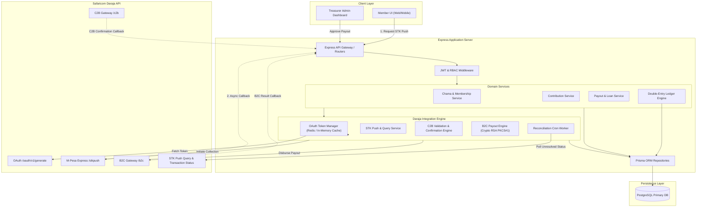
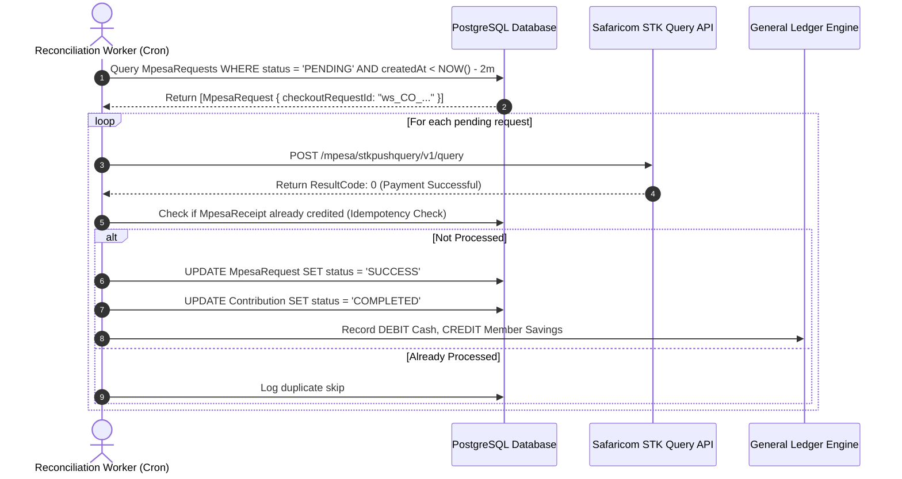
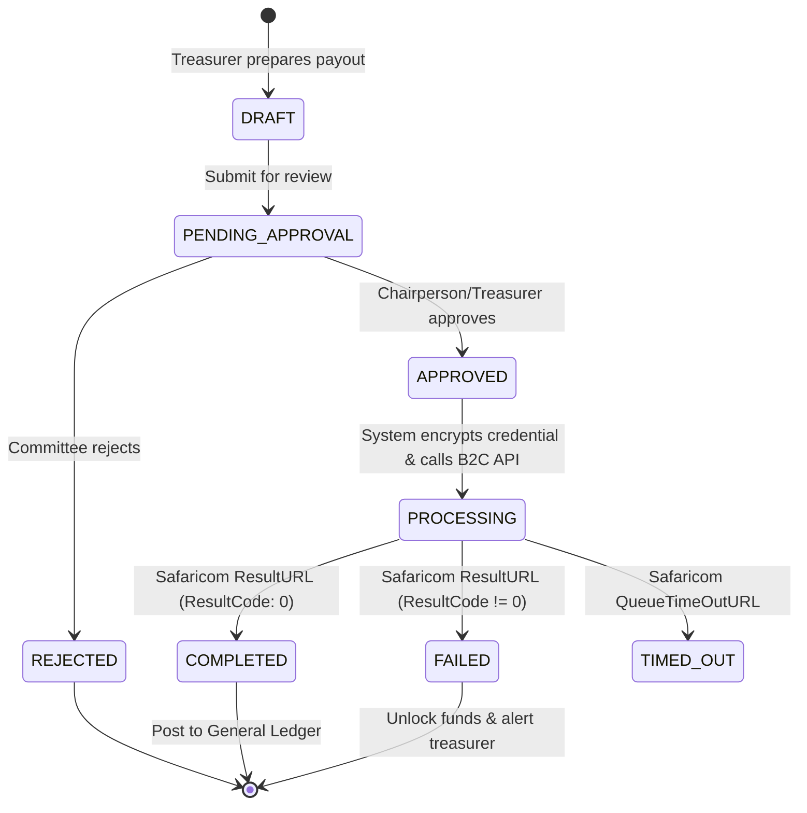
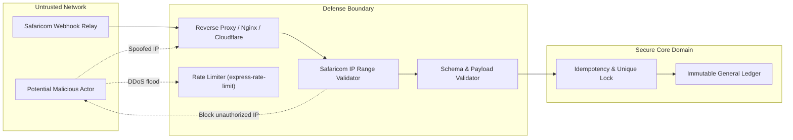

# Chama Management Application — Architectural Implementation Plan
## Safaricom Daraja M-Pesa FinTech Integration Engine

> **Document Type:** Architectural Blueprint & Phased Engineering Roadmap  
> **Target System:** Node.js 20+ (CommonJS), Express, PostgreSQL, Prisma ORM, Safaricom Daraja 3.0 API  
> **Scope:** Savings Group (Chama) Management with Automated Inbound Collections (STK Push & C2B Paybill), Outbound Automated Disbursements (B2C Payouts & Loans), Reconciliation Fallbacks, and Double-Entry General Ledger.

---

## Table of Contents
1. [Executive Summary & System Architecture](#1-executive-summary--system-architecture)
2. [Folder Structure & Architectural Boundaries](#2-folder-structure--architectural-boundaries)
3. [Full Database Schema (Prisma Models) & Relationship Analysis](#3-full-database-schema-prisma-models--relationship-analysis)
4. [Complete API Specification](#4-complete-api-specification)
5. [Educational Phased Roadmap (Phases 1 through 7)](#5-educational-phased-roadmap-phases-1-through-7)
   - [Phase 1: Project Initialization, PostgreSQL/Prisma Foundation, & Daraja OAuth Engine](#phase-1-project-initialization-postgresqlprisma-foundation--daraja-oauth-engine)
   - [Phase 2: M-Pesa Express (STK Push) & Asynchronous Webhook Receiver](#phase-2-m-pesa-express-stk-push--asynchronous-webhook-receiver)
   - [Phase 3: Production Hardening: Idempotency, STK Query Reconciliation & State Machine](#phase-3-production-hardening-idempotency-stk-query-reconciliation--state-machine)
   - [Phase 4: Customer-to-Business (C2B) Paybill Integration & Auto-Matching](#phase-4-customer-to-business-c2b-paybill-integration--auto-matching)
   - [Phase 5: Business-to-Customer (B2C) Disbursement Engine, Approval Workflow & PKCS#1 Encryption](#phase-5-business-to-customer-b2c-disbursement-engine-approval-workflow--pkcs1-encryption)
   - [Phase 6: Double-Entry Financial Ledger, Member Statements & Chama Reports](#phase-6-double-entry-financial-ledger-member-statements--chama-reports)
   - [Phase 7: Frontend Interface (Vanilla HTML/Fetch to React) & Production Go-Live Verification](#phase-7-frontend-interface-vanilla-htmlfetch-to-react--production-go-live-verification)
6. [Security Architecture & Fraud Prevention](#6-security-architecture--fraud-prevention)
7. [Daraja Deep Dive, Async Life Cycles & Pitfalls Reference](#7-daraja-deep-dive-async-life-cycles--pitfalls-reference)
8. [Testing & Local Simulation Strategy](#8-testing--local-simulation-strategy)
9. [Assumptions, Risks & Technical Clarifications](#9-assumptions-risks--technical-clarifications)

---

## 1. Executive Summary & System Architecture

A **Chama** is an informal or formal cooperative financial group prevalent in East Africa. Members pool financial resources on a scheduled basis (weekly or monthly) to save, disburse revolving payouts (merry-go-round), issue micro-loans, or finance group investments.

Integrating the **Safaricom Daraja M-Pesa API** transitions a Chama from error-prone manual bookkeeping (cash receipts, disputed bank slips, forged SMS messages) into an automated, auditable FinTech platform.

### High-Level Architecture Flowchart



### Key Architectural Tenets:
1. **Asynchronous Non-Blocking Processing:** Safaricom calls are inherently asynchronous. The backend *never* holds an open HTTP connection to the client while waiting for M-Pesa PIN entry.
2. **Idempotent Webhooks:** Network timeouts can cause Safaricom to resend callbacks up to 3 times. Every callback endpoint must be idempotent, deduplicating via unique `CheckoutRequestID`, `MerchantRequestID`, or `TransactionID`.
3. **Double-Entry General Ledger:** Money movements are never stored solely as a balance number on a table. Every shilling collected or disbursed generates balanced debits and credits in an immutable `ledger_entries` table.
4. **Defense in Depth Security:** Public callback URLs validate incoming IP subnets, verify request signatures/tokens, and sanitize payloads before passing them to internal transaction workers.

---

## 2. Folder Structure & Architectural Boundaries

The project adopts a **Modular Layered Architecture** with strict separation between HTTP transport, domain logic, external third-party gateways, and database access.

```
chama-management-app/
├── .env.example                  # Environment configuration template
├── .gitignore                    # Standard Node & environment ignore list
├── package.json                  # Dependencies and execution scripts
├── prisma/
│   ├── schema.prisma             # Primary Prisma data model definitions
│   ├── seed.js                   # Database seeder (Test users, demo chama)
│   └── migrations/               # Prisma migration history
├── certs/
│   ├── sandbox-cert.cer          # Safaricom Sandbox RSA Public Key Certificate
│   └── production-cert.cer       # Safaricom Production RSA Public Key Certificate
├── src/
│   ├── config/                   # Centralized configuration loaders
│   │   ├── env.js                # Environment variable validator (dotenv + Joi/Zod)
│   │   ├── constants.js          # Result codes, transaction types, role enums
│   │   └── database.js           # Prisma client singleton instance
│   ├── common/                   # Shared cross-cutting concerns
│   │   ├── errors/               # Custom AppError, NotFoundError, DarajaError classes
│   │   ├── middleware/           # auth.js, roleGuard.js, errorHandler.js, rateLimiter.js
│   │   └── utils/                # dateUtils.js, phoneFormatter.js, logger.js
│   ├── modules/                  # Vertical domain feature modules
│   │   ├── auth/                 # Authentication, JWT issuance, password hashing
│   │   │   ├── auth.controller.js
│   │   │   ├── auth.service.js
│   │   │   └── auth.routes.js
│   │   ├── chamas/               # Chama group management, rules, member rosters
│   │   │   ├── chamas.controller.js
│   │   │   ├── chamas.service.js
│   │   │   └── chamas.routes.js
│   │   ├── contributions/        # Member savings deposits & schedules
│   │   │   ├── contributions.controller.js
│   │   │   ├── contributions.service.js
│   │   │   └── contributions.routes.js
│   │   ├── payouts/              # Merry-go-round turns, loans, B2C transfers
│   │   │   ├── payouts.controller.js
│   │   │   ├── payouts.service.js
│   │   │   └── payouts.routes.js
│   │   ├── ledger/               # Double-entry ledger, reporting, statements
│   │   │   ├── ledger.service.js
│   │   │   ├── ledger.controller.js
│   │   │   └── ledger.routes.js
│   │   └── mpesa/                # Safaricom Daraja Gateway module
│   │       ├── services/
│   │       │   ├── darajaAuth.service.js         # OAuth caching engine
│   │       │   ├── darajaStk.service.js          # STK push & query client
│   │       │   ├── darajaC2b.service.js          # C2B URL registration & confirmation
│   │       │   ├── darajaB2c.service.js          # B2C client with PKCS#1 encryption
│   │       │   └── darajaInquiry.service.js      # Balance, Status & Reversal
│   │       ├── controllers/
│   │       │   ├── mpesaCallback.controller.js   # Public webhook ingestion
│   │       │   └── mpesaOperations.controller.js # Administrative Daraja triggers
│   │       ├── mpesa.routes.js                   # Webhook and operations routing
│   │       └── helpers/
│   │           ├── securityCredential.helper.js  # Node.js crypto RSA utility
│   │           ├── darajaResponseMapper.js       # Safaricom code-to-human explanations
│   │           └── callbackValidator.js          # IP Whitelisting & header checks
│   ├── jobs/                     # Background tasks and recurring crons
│   │   ├── reconciliation.cron.js# Polling STK Query for stale PENDING payments
│   │   └── scheduler.js          # Node-cron initialization
│   ├── app.js                    # Express application factory & middleware setup
│   └── server.js                 # Server listener & graceful shutdown handlers
├── public/                       # Phase 7 frontend static files (HTML/CSS/JS)
│   ├── css/
│   │   └── style.css
│   ├── js/
│   │   ├── api.js                # Fetch wrapper with JWT headers
│   │   ├── auth.js               # Login and register DOM handlers
│   │   ├── dashboard.js          # Member & Treasurer views
│   │   └── mpesa.js              # STK trigger & real-time polling widget
│   ├── index.html                # Landing & login
│   ├── register.html             # User registration
│   ├── dashboard.html            # Core chama dashboard
│   └── statement.html            # Member statement printable view
└── tests/                        # Automated unit and integration suites
    ├── mocks/
    │   ├── darajaResponses.mock.js
    │   └── callbackPayloads.mock.js
    ├── unit/
    └── integration/
```

---

## 3. Full Database Schema (Prisma Models) & Relationship Analysis

The schema is built for PostgreSQL using Prisma ORM. It enforces relational integrity, audit trails, and strict status transitions.

```prisma
datasource db {
  provider = "postgresql"
  url      = env("DATABASE_URL")
}

generator client {
  provider = "prisma-client-js"
}

// -------------------------------------------------------------
// ENUMS
// -------------------------------------------------------------

enum UserRole {
  ADMIN
  TREASURER
  MEMBER
}

enum ChamaRole {
  CHAIRPERSON
  TREASURER
  SECRETARY
  MEMBER
}

enum ChamaType {
  MERRY_GO_ROUND
  SAVINGS_AND_LOAN
  INVESTMENT
}

enum Frequency {
  WEEKLY
  BIWEEKLY
  MONTHLY
}

enum MembershipStatus {
  ACTIVE
  SUSPENDED
  EXITED
}

enum ContributionStatus {
  PENDING
  COMPLETED
  FAILED
  OVERDUE
  REVERSED
}

enum PaymentChannel {
  STK_PUSH
  C2B_PAYBILL
  MANUAL_CASH
  BANK_TRANSFER
}

enum MpesaTransactionType {
  STK_PUSH
  C2B
  B2C
  STK_QUERY
  TRANSACTION_STATUS
  ACCOUNT_BALANCE
  REVERSAL
}

enum MpesaRequestStatus {
  INITIATED
  PENDING
  SUCCESS
  FAILED
  TIMEOUT
  CANCELLED
}

enum PayoutType {
  MERRY_GO_ROUND_ROTATION
  LOAN_DISBURSEMENT
  DIVIDEND
  WELFARE
}

enum PayoutStatus {
  DRAFT
  PENDING_APPROVAL
  APPROVED
  PROCESSING
  COMPLETED
  FAILED
  REJECTED
}

enum LoanStatus {
  PENDING_APPROVAL
  APPROVED
  DISBURSED
  ACTIVE
  PAID_OFF
  DEFAULTED
  REJECTED
}

enum LedgerAccount {
  CASH_MPESA
  MEMBER_SAVINGS
  LOANS_RECEIVABLE
  INTEREST_INCOME
  FINES_PENALTIES
  PAYOUTS_PAYABLE
}

enum EntryType {
  DEBIT
  CREDIT
}

enum LedgerRefType {
  CONTRIBUTION
  PAYOUT
  LOAN_ISSUANCE
  LOAN_REPAYMENT
  REVERSAL
  ADJUSTMENT
}

// -------------------------------------------------------------
// CORE DOMAIN MODELS
// -------------------------------------------------------------

model User {
  id              String         @id @default(uuid())
  email           String         @unique
  passwordHash    String
  fullName        String
  phoneNumber     String         @unique // Format: 2547XXXXXXXX or 2541XXXXXXXX
  nationalId      String?        @unique
  role            UserRole       @default(MEMBER)
  isActive        Boolean        @default(true)
  createdAt       DateTime       @default(now())
  updatedAt       DateTime       @updatedAt

  memberships     Membership[]
  createdChamas   Chama[]        @relation("ChamaCreator")
  approvedPayouts Payout[]       @relation("PayoutApprover")
  auditLogs       AuditLog[]

  @@index([phoneNumber])
  @@index([email])
}

model Chama {
  id                    String        @id @default(uuid())
  chamaCode             String        @unique // E.g. "CH01" used for centralized Paybill prefix routing
  name                  String
  description           String?
  registrationNumber    String?       @unique
  type                  ChamaType     @default(SAVINGS_AND_LOAN)
  contributionFrequency Frequency     @default(MONTHLY)
  contributionAmount    Decimal       @db.Decimal(12, 2)
  payoutOrderStrategy   String?       // E.g. "SEQUENTIAL_ROTATION", "BALLOT", "LOAN_REQUEST"
  paybillNumber         String?       // Centralized platform shortcode (e.g. 600991 / 174379)
  createdById           String
  createdBy             User          @relation("ChamaCreator", fields: [createdById], references: [id])
  createdAt             DateTime      @default(now())
  updatedAt             DateTime      @updatedAt

  memberships           Membership[]
  contributions         Contribution[]
  payouts               Payout[]
  loans                 Loan[]
  ledgerEntries         LedgerEntry[]

  @@index([chamaCode])
  @@index([createdById])
}

model Membership {
  id            String            @id @default(uuid())
  userId        String
  chamaId       String
  memberNumber  String            // Unique identifier per Chama (e.g. "CH01-M004" used as C2B BillRefNumber)
  roleInChama   ChamaRole         @default(MEMBER)
  status        MembershipStatus  @default(ACTIVE)
  rotationIndex Int?              // Turn sequence for Merry-Go-Round
  joinedAt      DateTime          @default(now())
  updatedAt     DateTime          @updatedAt

  user          User              @relation(fields: [userId], references: [id], onDelete: Cascade)
  chama         Chama             @relation(fields: [chamaId], references: [id], onDelete: Cascade)
  contributions Contribution[]
  payouts       Payout[]
  loans         Loan[]

  @@unique([chamaId, memberNumber])
  @@unique([chamaId, userId])
  @@index([memberNumber])
  @@index([userId])
  @@index([chamaId])
}

model Contribution {
  id                  String             @id @default(uuid())
  membershipId        String
  chamaId             String
  amount              Decimal            @db.Decimal(12, 2)
  dueDate             DateTime
  paymentDate         DateTime?
  status              ContributionStatus @default(PENDING)
  channel             PaymentChannel     @default(STK_PUSH)
  mpesaReceiptNumber  String?            @unique // Unique Safaricom Receipt: e.g. "QK87ABC123"
  mpesaRequestId      String?            @unique // Links directly to the request tracking record
  notes               String?
  createdAt           DateTime           @default(now())
  updatedAt           DateTime           @updatedAt

  membership          Membership         @relation(fields: [membershipId], references: [id], onDelete: Restrict)
  chama               Chama              @relation(fields: [chamaId], references: [id], onDelete: Restrict)
  mpesaRequest        MpesaRequest?      @relation(fields: [mpesaRequestId], references: [id])

  @@index([membershipId])
  @@index([chamaId])
  @@index([status])
  @@index([dueDate])
  @@index([mpesaReceiptNumber])
}

// -------------------------------------------------------------
// DARAJA M-PESA AUDIT & INTEGRATION ENGINE MODELS
// -------------------------------------------------------------

model MpesaRequest {
  id                        String               @id @default(uuid())
  transactionType           MpesaTransactionType
  shortCode                 String               // Paybill / Till Number (e.g. 174379, 600991)
  phoneNumber               String               // Sender or Recipient: 2547XXXXXXXX
  amount                    Decimal              @db.Decimal(12, 2)
  accountReference          String               // Account Reference passed to Daraja (BillRefNumber)
  transactionDesc           String               // Description sent to Daraja

  // Unique Identifiers issued by Safaricom during synchronous handshake:
  checkoutRequestId         String?              @unique // STK Push checkout request ID
  merchantRequestId         String?              @index  // STK Push merchant request ID
  conversationId            String?              @unique // B2C / Query / Reversal conversation ID
  originatorConversationId  String?              @unique // B2C / Query originator conversation ID

  status                    MpesaRequestStatus   @default(INITIATED)
  resultCode                Int?                 // Final numeric code from Safaricom callback
  resultDesc                String?              // Final descriptive text from Safaricom
  rawInitialResponse        Json?                // Initial sync response from Daraja
  retryCount                Int                  @default(0)
  lastQueriedAt             DateTime?
  createdAt                 DateTime             @default(now())
  updatedAt                 DateTime             @updatedAt

  callbacks                 MpesaCallback[]
  contribution              Contribution?
  payout                    Payout?

  @@index([checkoutRequestId])
  @@index([conversationId])
  @@index([status, createdAt])
}

model MpesaCallback {
  id                  String               @id @default(uuid())
  mpesaRequestId      String?
  transactionType     MpesaTransactionType
  checkoutRequestId   String?              @index
  conversationId      String?              @index
  mpesaReceiptNumber  String?              @index
  resultCode          Int
  resultDesc          String
  rawPayload          Json                 // The exact untouched JSON payload received from Safaricom
  sourceIp            String?              // Originating IP address of the webhook request
  isProcessed         Boolean              @default(false)
  processedAt         DateTime?
  processingError     String?
  createdAt           DateTime             @default(now())

  mpesaRequest        MpesaRequest?        @relation(fields: [mpesaRequestId], references: [id])

  @@index([mpesaReceiptNumber])
  @@index([isProcessed])
}

// -------------------------------------------------------------
// PAYOUTS & DISBURSEMENTS
// -------------------------------------------------------------

model Payout {
  id                    String        @id @default(uuid())
  chamaId               String
  membershipId          String
  payoutType            PayoutType    @default(MERRY_GO_ROUND_ROTATION)
  amount                Decimal       @db.Decimal(12, 2)
  scheduledDate         DateTime
  approvedByTreasurerId String?
  approvedAt            DateTime?
  status                PayoutStatus  @default(DRAFT)
  mpesaRequestId        String?       @unique
  mpesaReceiptNumber    String?       @unique // B2C Safaricom receipt
  notes                 String?
  createdAt             DateTime      @default(now())
  updatedAt             DateTime      @updatedAt

  chama                 Chama         @relation(fields: [chamaId], references: [id])
  membership            Membership    @relation(fields: [membershipId], references: [id])
  approvedBy            User?         @relation("PayoutApprover", fields: [approvedByTreasurerId], references: [id])
  mpesaRequest          MpesaRequest? @relation(fields: [mpesaRequestId], references: [id])

  @@index([chamaId])
  @@index([membershipId])
  @@index([status])
}

model Loan {
  id                    String          @id @default(uuid())
  chamaId               String
  membershipId          String
  principalAmount       Decimal         @db.Decimal(12, 2)
  annualInterestRate    Decimal         @db.Decimal(5, 2)  // E.g. 12.00 (12% per year = 1% monthly on reducing balance)
  durationMonths        Int             // E.g. 6 months
  outstandingPrincipal  Decimal         @db.Decimal(12, 2) // Reducing principal balance
  status                LoanStatus      @default(PENDING_APPROVAL)
  payoutId              String?         @unique            // Links to B2C disbursement payout
  approvedByTreasurerId String?
  disbursedAt           DateTime?
  dueDate               DateTime?
  createdAt             DateTime        @default(now())
  updatedAt             DateTime        @updatedAt

  chama                 Chama           @relation(fields: [chamaId], references: [id])
  membership            Membership      @relation(fields: [membershipId], references: [id])
  repayments            LoanRepayment[]

  @@index([chamaId])
  @@index([membershipId])
  @@index([status])
}

model LoanRepayment {
  id                  String         @id @default(uuid())
  loanId              String
  amount              Decimal        @db.Decimal(12, 2) // Total paid (Principal + Interest)
  principalPaid       Decimal        @db.Decimal(12, 2) // Portion allocated to reduce principal
  interestPaid        Decimal        @db.Decimal(12, 2) // Portion allocated to monthly interest
  remainingPrincipal  Decimal        @db.Decimal(12, 2) // New outstanding principal after this payment
  channel             PaymentChannel @default(STK_PUSH)
  mpesaReceiptNumber  String?        @unique            // M-Pesa receipt
  createdAt           DateTime       @default(now())

  loan                Loan           @relation(fields: [loanId], references: [id], onDelete: Restrict)

  @@index([loanId])
  @@index([mpesaReceiptNumber])
}

// -------------------------------------------------------------
// GENERAL LEDGER & AUDITING (DOUBLE ENTRY)
// -------------------------------------------------------------

model LedgerEntry {
  id            String        @id @default(uuid())
  chamaId       String
  accountType   LedgerAccount
  entryType     EntryType     // DEBIT or CREDIT
  amount        Decimal       @db.Decimal(12, 2)
  balanceAfter  Decimal       @db.Decimal(14, 2)
  referenceType LedgerRefType
  referenceId   String        // ID of Contribution, Payout, etc.
  description   String
  createdAt     DateTime      @default(now())

  chama         Chama         @relation(fields: [chamaId], references: [id])

  @@index([chamaId, accountType])
  @@index([referenceId])
  @@index([createdAt])
}

model AuditLog {
  id          String   @id @default(uuid())
  userId      String?
  action      String   // E.g. "USER_LOGIN", "PAYOUT_APPROVED", "REVERSAL_TRIGGERED"
  ipAddress   String?
  userAgent   String?
  details     Json?
  createdAt   DateTime @default(now())

  user        User?    @relation(fields: [userId], references: [id])

  @@index([userId])
  @@index([action])
  @@index([createdAt])
}
```

### Detailed Schema & Relationship Analysis

#### 1. Why `mpesa_requests` and `mpesa_callbacks` are separated
- `MpesaRequest` represents our internal system's intent to perform an operation (an outgoing call to STK push, B2C, or query). It tracks state (`INITIATED`, `PENDING`, `SUCCESS`, `FAILED`) and holds the identifier Safaricom returned during the synchronous handshake (`CheckoutRequestID` or `ConversationID`).
- `MpesaCallback` is an append-only audit log for every incoming webhook payload pushed by Safaricom. Safaricom may send duplicate callbacks for the same request if your server responds slowly. By saving the raw callback independently before parsing, you ensure:
  1. No data is lost even if your business logic crashes during processing.
  2. High-speed response (HTTP 200 OK) back to Safaricom within their 5-second deadline.
  3. Replayability for debugging discrepancies.

#### 2. Unique Constraints & Indices
- `Contribution.mpesaReceiptNumber` is `@unique`: Prevents double-crediting when callbacks are resent or if a member submits the same M-Pesa receipt twice.
- `Membership.@@unique([chamaId, memberNumber])`: Enforces that each member in a Chama has a unique account reference (e.g. `CH01-005`), which acts as the `BillRefNumber` during C2B payments.
- `MpesaRequest.checkoutRequestId` is `@unique`: Enables $O(1)$ lookups when Safaricom sends the asynchronous STK push completion callback.

#### 3. Double-Entry Principle in `LedgerEntry`
Money cannot magically appear or disappear. Every financial transaction results in at least two balanced ledger entries:
- **Member Pays Contribution (Ksh 2,000):**
  - `DEBIT: CASH_MPESA` (+2,000 asset)
  - `CREDIT: MEMBER_SAVINGS` (+2,000 liability to member)
- **Treasurer Sends Payout / Loan (Ksh 10,000):**
  - `DEBIT: PAYOUTS_PAYABLE` or `LOANS_RECEIVABLE` (+10,000)
  - `CREDIT: CASH_MPESA` (-10,000 asset)

This prevents data discrepancies caused by editing database rows directly and provides transparent audit trails for Chama members.

---

## 4. Complete API Specification

All protected endpoints require the HTTP Header:  
`Authorization: Bearer <JWT_ACCESS_TOKEN>`

### 4.1 Authentication & Authorization (`/api/v1/auth`)

| Method | Endpoint | Auth | Description | Request Body | Response (Success) |
| :--- | :--- | :--- | :--- | :--- | :--- |
| `POST` | `/api/v1/auth/register` | Public | Register new user | `{ "fullName": "Jane Doe", "email": "jane@example.com", "phoneNumber": "254712345678", "password": "SecurePassword123!" }` | `201 Created` `{ "success": true, "user": { "id": "uuid", "email": "...", "role": "MEMBER" } }` |
| `POST` | `/api/v1/auth/login` | Public | Authenticate & get JWT | `{ "email": "jane@example.com", "password": "SecurePassword123!" }` | `200 OK` `{ "token": "jwt_token", "user": { "id": "uuid", "role": "MEMBER" } }` |
| `GET` | `/api/v1/auth/me` | User | Get current profile | *None* | `200 OK` `{ "user": { "id": "...", "fullName": "...", "phone": "..." } }` |

### 4.2 Chama Management (`/api/v1/chamas`)

| Method | Endpoint | Auth | Description | Request Body | Response (Success) |
| :--- | :--- | :--- | :--- | :--- | :--- |
| `POST` | `/api/v1/chamas` | Treasurer/Admin | Create a new savings group | `{ "name": "Umoja Savings", "type": "SAVINGS_AND_LOAN", "contributionFrequency": "MONTHLY", "contributionAmount": 2500 }` | `201 Created` `{ "id": "chama_id", "name": "Umoja Savings" }` |
| `GET` | `/api/v1/chamas` | Authenticated | List chamas user belongs to | *None* | `200 OK` `{ "chamas": [...] }` |
| `GET` | `/api/v1/chamas/:id` | Member/Treasurer | Fetch specific chama details | *None* | `200 OK` `{ "chama": { ... } }` |
| `POST` | `/api/v1/chamas/:id/members` | Treasurer | Enroll member with memberNumber | `{ "userId": "user_uuid", "memberNumber": "CH01-M004", "roleInChama": "MEMBER" }` | `201 Created` `{ "membershipId": "...", "memberNumber": "CH01-M004" }` |
| `GET` | `/api/v1/chamas/:id/members` | Member/Treasurer | Roster of members & numbers | *None* | `200 OK` `{ "members": [...] }` |
| `GET` | `/api/v1/chamas/:id/rotation` | Member/Treasurer | View Merry-Go-Round rotation order | *None* | `200 OK` `{ "rotation": [ { "rotationIndex": 1, "memberNumber": "CH01-M001", "scheduledDate": "..." } ] }` |
| `PUT` | `/api/v1/chamas/:id/rotation/swap` | Treasurer | Swap rotation positions between 2 members | `{ "memberAId": "membership_uuid_1", "memberBId": "membership_uuid_2", "reason": "Emergency swap approved by committee" }` | `200 OK` `{ "success": true, "message": "Rotation positions swapped successfully" }` |

### 4.3 Inbound Collections — M-Pesa Express (STK Push) (`/api/v1/contributions`)

| Method | Endpoint | Auth | Description | Request Body | Response (Success) |
| :--- | :--- | :--- | :--- | :--- | :--- |
| `POST` | `/api/v1/contributions/stk-push` | Member | Initiate STK prompt on phone | `{ "chamaId": "uuid", "amount": 2500, "phoneNumber": "254712345678" }` | `202 Accepted` `{ "success": true, "checkoutRequestId": "ws_CO_...", "customerMessage": "STK Prompt sent to phone" }` |
| `GET` | `/api/v1/contributions/stk-status/:checkoutRequestId` | Member | Polling endpoint for frontend UI | *None* | `200 OK` `{ "status": "PENDING" \| "COMPLETED" \| "FAILED", "receipt": "QK87ABC123" }` |

### 4.4 Inbound Collections — C2B Paybill (`/api/v1/mpesa/c2b`)

| Method | Endpoint | Auth | Description | Request Body | Response (Success) |
| :--- | :--- | :--- | :--- | :--- | :--- |
| `POST` | `/api/v1/mpesa/c2b/register` | Admin | Register Validation & Confirmation URLs | `{ "shortCode": "600991", "responseType": "Completed" }` | `200 OK` `{ "OriginatorConversationID": "...", "ResponseDescription": "success" }` |
| `POST` | `/api/v1/mpesa/c2b/simulate` | Admin (Sandbox) | Simulate a customer paying paybill | `{ "shortCode": "600991", "amount": 1000, "billRefNumber": "CH01-M004", "phoneNumber": "254708374149" }` | `200 OK` `{ "response": "Transaction accepted" }` |

### 4.5 Outbound Disbursements — B2C Payouts (`/api/v1/payouts`)

| Method | Endpoint | Auth | Description | Request Body | Response (Success) |
| :--- | :--- | :--- | :--- | :--- | :--- |
| `POST` | `/api/v1/payouts` | Treasurer | Create payout proposal | `{ "chamaId": "uuid", "membershipId": "uuid", "amount": 15000, "payoutType": "MERRY_GO_ROUND_ROTATION" }` | `201 Created` `{ "payoutId": "uuid", "status": "PENDING_APPROVAL" }` |
| `POST` | `/api/v1/payouts/:id/approve` | Treasurer | Approve proposal and dispatch B2C | *None* | `202 Accepted` `{ "status": "PROCESSING", "conversationId": "AG_..." }` |
| `POST` | `/api/v1/payouts/:id/reject` | Treasurer | Reject proposed payout | `{ "reason": "Insufficient group reserves" }` | `200 OK` `{ "status": "REJECTED" }` |

### 4.6 Loans & Reducing Balance Engine (`/api/v1/chamas/:id/loans`)

| Method | Endpoint | Auth | Description | Request Body | Response (Success) |
| :--- | :--- | :--- | :--- | :--- | :--- |
| `POST` | `/api/v1/chamas/:id/loans` | Member/Treasurer | Apply for or issue loan | `{ "membershipId": "uuid", "principalAmount": 20000, "annualInterestRate": 12.0, "durationMonths": 6 }` | `201 Created` `{ "loanId": "uuid", "status": "PENDING_APPROVAL", "monthlyPaymentEstimate": 3450.50 }` |
| `GET` | `/api/v1/chamas/:id/loans/:loanId/schedule` | Member/Treasurer | Get monthly reducing balance schedule | *None* | `200 OK` `{ "schedule": [ { "month": 1, "interestDue": 200.00, "principalDue": 3333.33, "totalDue": 3533.33, "remainingPrincipal": 16666.67 } ] }` |
| `POST` | `/api/v1/chamas/:id/loans/:loanId/approve` | Treasurer | Approve loan and disburse via B2C | *None* | `202 Accepted` `{ "status": "DISBURSED", "payoutId": "uuid" }` |
| `POST` | `/api/v1/chamas/:id/loans/:loanId/repay` | Member | Make repayment (STK Push) | `{ "amount": 3500, "phoneNumber": "254712345678" }` | `202 Accepted` `{ "checkoutRequestId": "ws_CO_...", "interestPortion": 200, "principalPortion": 3300 }` |

### 4.7 Daraja Webhook Receivers (`/api/v1/mpesa/callbacks`)
*Public endpoints reached by Safaricom IP ranges only.*

| Method | Endpoint | Auth | Safaricom Service | Response to Safaricom |
| :--- | :--- | :--- | :--- | :--- |
| `POST` | `/api/v1/mpesa/callbacks/stk` | Public | STK Push completion callback | `200 OK` `{"ResultCode": 0, "ResultDesc": "Accepted"}` |
| `POST` | `/api/v1/mpesa/callbacks/c2b-validation` | Public | C2B Validation (Real-time account check) | `200 OK` `{"ResultCode": 0, "ResultDesc": "Accepted"}` or `{"ResultCode": "C2B00012", "ResultDesc": "Invalid Account"}` |
| `POST` | `/api/v1/mpesa/callbacks/c2b-confirmation` | Public | C2B Final Payment Notification | `200 OK` `{"ResultCode": 0, "ResultDesc": "Accepted"}` |
| `POST` | `/api/v1/mpesa/callbacks/b2c-result` | Public | B2C Disbursement Outcome | `200 OK` `{"ResultCode": 0, "ResultDesc": "Accepted"}` |
| `POST` | `/api/v1/mpesa/callbacks/b2c-timeout` | Public | B2C Queue Timeout Event | `200 OK` `{"ResultCode": 0, "ResultDesc": "Accepted"}` |
| `POST` | `/api/v1/mpesa/callbacks/status-result` | Public | Transaction Status Callback | `200 OK` `{"ResultCode": 0, "ResultDesc": "Accepted"}` |
| `POST` | `/api/v1/mpesa/callbacks/balance-result` | Public | Account Balance Callback | `200 OK` `{"ResultCode": 0, "ResultDesc": "Accepted"}` |
| `POST` | `/api/v1/mpesa/callbacks/reversal-result` | Public | Transaction Reversal Callback | `200 OK` `{"ResultCode": 0, "ResultDesc": "Accepted"}` |

### 4.8 Operations, Ledger & Financial Statements (`/api/v1/chamas/:id/ledger`)

| Method | Endpoint | Auth | Description |
| :--- | :--- | :--- | :--- |
| `GET` | `/api/v1/chamas/:id/ledger` | Treasurer | Full double-entry general ledger log |
| `GET` | `/api/v1/chamas/:id/statements/me` | Member | Individual member financial statement (contributions vs payouts) |
| `GET` | `/api/v1/chamas/:id/reports/monthly` | Treasurer | Monthly aggregate summary (total deposits, loans outstanding, cash in M-Pesa) |
| `POST` | `/api/v1/mpesa/operations/account-balance` | Treasurer | Trigger live Daraja balance query for shortcode |
| `POST` | `/api/v1/mpesa/operations/transaction-status` | Treasurer | Trigger query for specific M-Pesa receipt code |

---

## 5. Educational Phased Roadmap (Phases 1 through 7)

---

### Phase 1: Project Initialization, PostgreSQL/Prisma Foundation, & Daraja OAuth Engine

#### 1. What We Are Doing and Why It Matters
Before any money can be requested or moved, our application must establish a rock-solid database schema and authenticate itself to Safaricom's servers. Daraja uses OAuth 2.0 Client Credentials: an access token valid for 3,599 seconds (1 hour). If your application requests a new token on every API call, Safaricom's rate limiter will throttle your IP (`429 Too Many Requests`). A centralized token caching mechanism is mandatory.

#### 2. How It Fits Into the Overall Architecture
The `darajaAuth.service.js` acts as an HTTP interceptor or gateway provider for all subsequent Daraja services (STK, B2C, C2B). PostgreSQL and Prisma provide the transactional bedrock for storing users, groups, and audit records.

#### 3. Key Concepts to Understand
- **HTTP Basic Auth vs Bearer Token:** Basic auth (`Authorization: Basic base64(consumer_key:consumer_secret)`) is only used when calling `/oauth/v1/generate`. All other Daraja endpoints consume the returned Bearer token.
- **In-Memory / Redis Token Caching:** Calculating expiry (`Date.now() + (expires_in - 300) * 1000`) with a 5-minute safety buffer prevents edge-case token expiration during in-flight requests.
- **Relational Integrity with Prisma:** Modeling foreign keys and indexed fields to ensure high performance under production query load.

#### 4. Curated Learning Resources
- **Daraja OAuth Official Docs:** [Safaricom Daraja Authentication API Docs](https://developer.safaricom.co.ke/APIs/Authorization)
- **Prisma with PostgreSQL Best Practices:** [Prisma Official PostgreSQL Guide](https://www.prisma.io/docs/getting-started/quickstart-prisma-postgres)
- **OAuth 2.0 Client Credentials Flow Deep Dive:** [Auth0 Client Credentials Flow Article](https://auth0.com/docs/get-started/authentication-and-authorization-flow/client-credentials-flow)
- **YouTube Search Term:** `"M-Pesa Daraja API OAuth Token Node.js tutorial"`
- **Estimated Study Time:** 45 minutes.

#### 5. What to Look for (Self-Assessment Checklist)
- [ ] Can you explain why encoding `consumer_key + ":" + consumer_secret` in Base64 is required?
- [ ] Do you know what happens if your server restarts? Does your token service gracefully request a new token?
- [ ] Have you verified that your database connection string in `.env` works with `npx prisma db push` or `npx prisma migrate dev`?

#### 6. Tasks
1. Initialize Node.js project with CommonJS (`npm init -y`).
2. Install dependencies: `express`, `dotenv`, `prisma`, `@prisma/client`, `axios`, `jsonwebtoken`, `bcryptjs`, `cors`, `helmet`, `morgan`. Install dev dependency: `nodemon`.
3. Set up `.env` and `.env.example`.
4. Configure Prisma schema with `User`, `Chama`, and `Membership` models. Run migration.
5. Build `src/modules/mpesa/services/darajaAuth.service.js`:
   - Fetch token via `axios.get('https://sandbox.safaricom.co.ke/oauth/v1/generate?grant_type=client_credentials')`.
   - Store token and `tokenExpiresAt` in memory.
   - Return cached token if valid; refresh if within 5 minutes of expiration.
6. Build a diagnostic route `GET /api/v1/mpesa/test-token` to verify token generation.

#### 7. Files to Create in Phase 1
- `src/config/env.js`
- `src/config/database.js`
- `src/config/constants.js`
- `src/common/errors/AppError.js`
- `src/common/middleware/errorHandler.js`
- `src/modules/mpesa/services/darajaAuth.service.js`
- `src/app.js`
- `src/server.js`
- `prisma/schema.prisma`

#### 8. Acceptance Criteria
- Running `node src/server.js` starts the Express server without errors.
- Invoking `GET /api/v1/mpesa/test-token` returns `{ "success": true, "token": "..." }` with a valid token string from Safaricom Sandbox.
- Subsequent calls within 50 minutes return the exact same cached token without calling Safaricom again.

#### 9. Manual Testing Steps
```bash
# 1. Start server
npm run start:dev

# 2. Curl the test-token endpoint
curl -X GET http://localhost:3000/api/v1/mpesa/test-token

# 3. Observe the server console logs:
# First call should print: "[DarajaAuth] Fetching fresh token from Safaricom..."
# Second call should print: "[DarajaAuth] Returning valid cached token..."
```

---

### Phase 2: M-Pesa Express (STK Push) & Asynchronous Webhook Receiver

#### 1. What We Are Doing and Why It Matters
STK Push (Lipa Na M-Pesa Online) enables the application to push a payment prompt directly to the member's mobile device. The member simply enters their secret M-Pesa PIN.  
The critical architectural requirement is that **STK Push is a two-step asynchronous process**:
1. Synchronous Handshake: Safaricom validates the request format and returns a `CheckoutRequestID`.
2. Asynchronous Webhook Callback: Once the user enters their PIN (or cancels), Safaricom sends an HTTP POST to our publicly accessible `CallbackURL`.

#### 2. How It Fits Into the Overall Architecture
The `contributions.controller.js` invokes `darajaStk.service.js`. An entry is created in `mpesa_requests` in a `PENDING` state. Safaricom sends the outcome to `mpesaCallback.controller.js`, which links the callback to the request via `CheckoutRequestID` and updates the `Contribution` table.

#### 3. Key Concepts to Understand
- **Password Generation Formula:**  
  `Password = Base64(BusinessShortCode + Passkey + Timestamp)`  
  Where `Timestamp` must strictly follow the format `YYYYMMDDHHMMSS` in East Africa Time (UTC+3).
- **Ngrok Tunneling:** Safaricom's cloud servers cannot ping `http://localhost:3000`. A secure public tunnel (e.g. `https://xxxx.ngrok-free.app`) must forward traffic to our local Express port.
- **Fast Webhook Acknowledgement:** Safaricom enforces a strict 5-second timeout on callbacks. The webhook controller must return `{ "ResultCode": 0, "ResultDesc": "Accepted" }` immediately, queuing or asynchronously updating the database.

#### 4. Curated Learning Resources
- **Official STK Push Documentation:** [Daraja M-Pesa Express (STK Push)](https://developer.safaricom.co.ke/APIs/MpesaExpressSimulate)
- **Ngrok Webhook Tunneling Guide:** [Ngrok Getting Started Guide](https://ngrok.com/docs/getting-started/)
- **Node.js Crypto & Buffer Base64 Encoding:** [Node.js Buffer Documentation](https://nodejs.org/api/buffer.html#buffers-and-character-encodings)
- **YouTube Search Term:** `"Daraja STK Push Node.js Express step by step tutorial"`
- **Estimated Study Time:** 60 minutes.

#### 5. What to Look for (Self-Assessment Checklist)
- [ ] Can you construct the timestamp `YYYYMMDDHHMMSS` using zero-padded UTC+3 numbers?
- [ ] Do you understand why your database should store the raw JSON callback before parsing it?
- [ ] If Safaricom sends `ResultCode: 1032`, do you know what that represents? (User canceled the prompt on their phone).

#### 6. Tasks
1. Set up an Ngrok tunnel: `ngrok http 3000`. Copy the HTTPS forwarding URL to `MPESA_CALLBACK_BASE_URL` in `.env`.
2. Implement password and timestamp generator helper: `src/modules/mpesa/helpers/darajaPassword.helper.js`.
3. Implement `darajaStk.service.js` with method `initiateStkPush({ phoneNumber, amount, accountReference, transactionDesc })`.
   - Endpoint: `POST https://sandbox.safaricom.co.ke/mpesa/stkpush/v1/processrequest`
4. Create `mpesa_requests` record with `CheckoutRequestID`, `MerchantRequestID`, and status `PENDING`.
5. Create `POST /api/v1/mpesa/callbacks/stk` in `mpesaCallback.controller.js`:
   - Store incoming payload in `mpesa_callbacks`.
   - Respond immediately with HTTP 200 `{ "ResultCode": 0, "ResultDesc": "Accepted" }`.
   - Extract `ResultCode`, `CheckoutRequestID`, and metadata (`MpesaReceiptNumber`, `Amount`, `PhoneNumber`).
   - If `ResultCode === 0`, mark `MpesaRequest` and `Contribution` as `COMPLETED`.

#### 7. Files to Create in Phase 2
- `src/modules/mpesa/helpers/darajaPassword.helper.js`
- `src/modules/mpesa/services/darajaStk.service.js`
- `src/modules/mpesa/controllers/mpesaCallback.controller.js`
- `src/modules/contributions/contributions.controller.js`
- `src/modules/contributions/contributions.service.js`
- `src/modules/contributions/contributions.routes.js`

#### 8. Acceptance Criteria
- Sending `POST /api/v1/contributions/stk-push` with test credentials triggers a phone SIM toolkit push in Sandbox (or mock acknowledgment).
- Entering PIN triggers Safaricom's POST request to your Ngrok endpoint.
- Express logs show HTTP 200 returned to Safaricom, and the database shows a new `MpesaCallback` record and an updated `Contribution` status of `COMPLETED`.

#### 9. Manual Testing Steps
```bash
# 1. Trigger STK push via cURL
curl -X POST http://localhost:3000/api/v1/contributions/stk-push \
  -H "Content-Type: application/json" \
  -H "Authorization: Bearer <USER_JWT>" \
  -d '{
    "chamaId": "<CHAMA_ID>",
    "amount": 10,
    "phoneNumber": "254708374149"
  }'

# 2. Inspect terminal running ngrok
# Look for: POST /api/v1/mpesa/callbacks/stk 200 OK

# 3. Verify in PostgreSQL using Prisma Studio
npx prisma studio
# Check mpesa_requests (status = SUCCESS) and contributions (status = COMPLETED)
```

---

### Phase 3: Production Hardening: Idempotency, STK Query Reconciliation & State Machine

#### 1. What We Are Doing and Why It Matters
In real-world networks, STK push callbacks fail or arrive late:
- The user enters their PIN, but their phone drops off the network temporarily.
- Safaricom's webhook retry mechanism sends the same callback three times.
- Your server restarts for a deployment right as a callback is transmitted.

Without a hardening layer, payments remain stuck in `PENDING`, causing member panic and repeated double-payments. In this phase, we build an **idempotent callback processor** and an **automated reconciliation cron worker** that queries Safaricom using **STK Push Query**.

#### 2. How It Fits Into the Overall Architecture
The `reconciliation.cron.js` worker runs periodically (e.g., every 5 minutes). It scans `mpesa_requests` for records stuck in `PENDING` for longer than 2 minutes. It calls `mpesa/stkpushquery/v1/query`. If Safaricom reports success, the system self-heals by finalizing the contribution without human intervention.



#### 3. Key Concepts to Understand
- **Idempotency Keying:** Ensuring that processing the same transaction 10 times produces the exact same outcome as processing it once.
- **Safaricom Result Codes:**
  - `0`: Success.
  - `1032`: Cancelled by user.
  - `1037`: Prompt timed out / unreachable SIM.
  - `1`: Insufficient funds.
  - `2001`: Invalid Initiator / Authentication failure.
- **Database Row Locking & Transactions:** Using Prisma's `$transaction([ ... ])` to guarantee that updating request status, updating contribution status, and writing ledger entries either all succeed together or all rollback.

#### 4. Curated Learning Resources
- **Daraja STK Push Query Docs:** [Safaricom STK Query Documentation](https://developer.safaricom.co.ke/APIs/MpesaExpressQuery)
- **Idempotency in Financial APIs:** [Stripe API Idempotency Architecture](https://stripe.com/blog/idempotency)
- **Node-Cron Task Scheduling Guide:** [Node-Cron Official Documentation](https://github.com/node-cron/node-cron)
- **YouTube Search Term:** `"STK Push Query reconciliation node.js cron mpesa"`
- **Estimated Study Time:** 60 minutes.

#### 5. What to Look for (Self-Assessment Checklist)
- [ ] Does your callback handler reject duplicate receipts by checking `prisma.contribution.findUnique({ where: { mpesaReceiptNumber } })`?
- [ ] Does the reconciliation cron avoid infinite loops by capping retries (`retryCount >= 3` transitions status to `TIMEOUT`)?
- [ ] Is your password for STK query generated fresh with the query timestamp?

#### 6. Tasks
1. Implement `darajaStk.service.js` -> `queryStkStatus(checkoutRequestId)`.
   - Endpoint: `POST https://sandbox.safaricom.co.ke/mpesa/stkpushquery/v1/query`
   - Uses `BusinessShortCode`, `Password`, `Timestamp`, and `CheckoutRequestID`.
2. Create comprehensive result code dictionary: `src/modules/mpesa/helpers/darajaResponseMapper.js`.
3. Wrap callback processing logic in `prisma.$transaction`:
   - Check if receipt already exists.
   - If not, update `MpesaRequest`, update `Contribution`, and create audit log.
4. Build `src/jobs/reconciliation.cron.js`:
   - Runs every 3 minutes.
   - Queries `MpesaRequest` where `status = 'PENDING'` and `createdAt <= NOW() - 2 minutes`.
   - Calls `queryStkStatus()`.
   - Maps response and resolves stale records.

#### 7. Files to Create in Phase 3
- `src/modules/mpesa/helpers/darajaResponseMapper.js`
- `src/jobs/reconciliation.cron.js`
- `src/jobs/scheduler.js`

#### 8. Acceptance Criteria
- Simulating a dropped callback (by withholding the callback response or simulating a pending record) results in the reconciliation cron detecting the record within 3 minutes.
- The cron successfully queries Safaricom, marks the request `SUCCESS`, and records the transaction without duplicate entries.
- Replaying the same webhook payload does not double-credit the user's account.

#### 9. Manual Testing Steps
```bash
# 1. Insert a mock stuck PENDING MpesaRequest in database
# 2. Trigger the reconciliation runner manually via Node script
node -e "require('./src/jobs/reconciliation.cron.js').runReconciliationJob()"

# 3. Observe output:
# [Recon] Found 1 pending transaction. Querying Daraja...
# [Recon] Safaricom returned ResultCode: 1032 (Cancelled by user).
# [Recon] Updated request status to CANCELLED.
```

---

### Phase 4: Customer-to-Business (C2B) Paybill Integration & Auto-Matching

#### 1. What We Are Doing and Why It Matters
While STK Push is convenient, many Chama members prefer navigating their phone's SIM menu:  
`Lipa Na M-Pesa -> Paybill -> Enter Business No (600991) -> Account No (CH01-M004) -> Amount -> PIN`.  
This is the **C2B (Customer to Business)** model.  
Without C2B integration, a treasurer must manually inspect group Paybill SMS messages and hand-type receipts. With our automated C2B engine:
1. **Validation URL:** Safaricom asks our server: *"Does member account `CH01-M004` exist?"* If valid, we accept; if invalid, Safaricom immediately rejects the payment and refunds the customer before money leaves their wallet!
2. **Confirmation URL:** Safaricom completes the transfer and delivers the verified receipt code and customer name to our webhook.

#### 2. How It Fits Into the Overall Architecture
The `darajaC2b.service.js` handles one-time URL registration. `mpesaCallback.controller.js` handles incoming validation and confirmation hooks. The `contributions.service.js` extracts the `BillRefNumber`, matches it to a `Membership`, and records the contribution.

#### 3. Key Concepts to Understand
- **Validation URL vs Confirmation URL:**
  - `ValidationURL`: Called **before** money moves. Can approve (`ResultCode: 0`) or reject (`ResultCode: "C2B00012"`).
  - `ConfirmationURL`: Called **after** money has moved. Informational; you cannot reject a confirmation.
- **ResponseType (`Completed` vs `Cancelled`):** If your validation URL goes down, `Completed` instructs Safaricom to accept payments anyway; `Cancelled` instructs Safaricom to fail them. For financial chamas, `Cancelled` prevents unmatched ghost deposits.
- **Account Number Sanitization & Centralized Paybill Prefix Routing:**  
  Because the platform operates on a **single centralized Paybill shortcode**, the `BillRefNumber` acts as the multi-tenant routing key:
  - Format: `<CHAMA_CODE>-<MEMBER_CODE>` (e.g. `CH01-M004`) or `<CHAMA_CODE>-L<LOAN_ID>` for loan repayments.
  - Parsing algorithm:
    ```javascript
    // e.g. "CH01-M004" -> chamaCode: "CH01", memberCode: "CH01-M004"
    const [chamaCode, memberSuffix] = rawBillRef.toUpperCase().trim().split('-');
    const chama = await prisma.chama.findUnique({ where: { chamaCode } });
    if (!chama) return rejectValidation("Unknown Chama group");
    
    const membership = await prisma.membership.findUnique({
      where: { chamaId_memberNumber: { chamaId: chama.id, memberNumber: rawBillRef } }
    });
    if (!membership || membership.status !== 'ACTIVE') return rejectValidation("Inactive or invalid member account");
    ```

#### 4. Curated Learning Resources
- **Official C2B API Documentation:** [Safaricom C2B API Overview](https://developer.safaricom.co.ke/APIs/CustomerToBusinessRegisterURL)
- **C2B Validation & Confirmation Deep Dive:** [Daraja C2B Walkthrough Article](https://dev.to/pauljuma/integrating-mpesa-c2b-in-nodejs-34fe)
- **YouTube Search Term:** `"M-Pesa C2B Validation and Confirmation Node.js"`
- **Estimated Study Time:** 60 minutes.

#### 5. What to Look for (Self-Assessment Checklist)
- [ ] Do you know what happens if your validation endpoint fails to return JSON within 2 seconds? (Safaricom follows the shortcode's fallback `ResponseType`).
- [ ] What is the exact JSON format Safaricom expects in validation response?  
  `{ "ResultCode": 0, "ResultDesc": "Accepted" }` or `{ "ResultCode": "C2B00012", "ResultDesc": "Rejected: Invalid Account" }`.
- [ ] How does the confirmation payload differ from the STK push payload? (C2B uses flat keys like `TransID`, `TransAmount`, `BillRefNumber`, `MSISDN`).

#### 6. Tasks
1. Build `darajaC2b.service.js`:
   - Implement `registerC2bUrls({ shortCode, responseType })` calling `POST https://sandbox.safaricom.co.ke/mpesa/c2b/v2/registerurl`.
2. Build Validation Webhook (`POST /api/v1/mpesa/callbacks/c2b-validation`):
   - Parse `BillRefNumber`.
   - Query `prisma.membership.findFirst({ where: { memberNumber: sanitizedBillRef, status: 'ACTIVE' } })`.
   - If found, return `{ "ResultCode": 0, "ResultDesc": "Validation successful" }`.
   - If not found, return `{ "ResultCode": "C2B00012", "ResultDesc": "Member account not recognized" }`.
3. Build Confirmation Webhook (`POST /api/v1/mpesa/callbacks/c2b-confirmation`):
   - Store raw payload in `mpesa_callbacks`.
   - Check if `TransID` already recorded.
   - Match `BillRefNumber` to `Membership`.
   - Create `Contribution` with `channel = C2B_PAYBILL`, `mpesaReceiptNumber = TransID`, status `COMPLETED`.
4. Build Sandbox Simulation route:
   - `POST https://sandbox.safaricom.co.ke/mpesa/c2b/v1/simulate`.

#### 7. Files to Create in Phase 4
- `src/modules/mpesa/services/darajaC2b.service.js`
- `src/modules/mpesa/controllers/mpesaC2b.controller.js`
- Update `src/modules/mpesa/mpesa.routes.js`

#### 8. Acceptance Criteria
- Executing C2B simulation with a valid `BillRefNumber` (e.g. `CH01-M004`) hits the validation endpoint, returns `0`, hits confirmation, and creates an automated `Contribution` in the database.
- Executing simulation with an unknown account (`INVALID999`) returns rejection code `C2B00012` and prevents deposit creation.

#### 9. Manual Testing Steps
```bash
# 1. Register URLs with Safaricom Sandbox
curl -X POST http://localhost:3000/api/v1/mpesa/c2b/register \
  -H "Authorization: Bearer <ADMIN_JWT>"

# 2. Simulate valid C2B Payment
curl -X POST http://localhost:3000/api/v1/mpesa/c2b/simulate \
  -H "Content-Type: application/json" \
  -H "Authorization: Bearer <ADMIN_JWT>" \
  -d '{
    "amount": 500,
    "billRefNumber": "CH01-M004",
    "phoneNumber": "254708374149"
  }'

# 3. Check logs:
# [C2B Validation] Member CH01-M004 verified. Approving.
# [C2B Confirmation] Received payment TransID: LGR0192837. Contribution recorded!
```

---

### Phase 5: Business-to-Customer (B2C) Disbursement Engine, Approval Workflow & PKCS#1 Encryption

#### 1. What We Are Doing and Why It Matters
Collecting money is only half the battle. A Chama must distribute funds:
- Merry-go-round payouts to the scheduled turn recipient.
- Approved emergency loans disbursed instantly to a member's M-Pesa wallet.

Sending money out of an organizational utility account (B2C) is high-risk. A single bug or unauthorized request could drain the treasury. We must enforce:
1. **Multi-Role Approval:** A treasurer or admin must initiate and approve a payout before it reaches Safaricom.
2. **Security Credential Generation:** Safaricom demands that the initiator's operator password be encrypted using their official **RSA X.509 Public Key Certificate** with **PKCS#1 v1.5 padding**.

#### 2. How It Fits Into the Overall Architecture
The `payouts.service.js` coordinates the workflow: `DRAFT -> PENDING_APPROVAL -> APPROVED -> PROCESSING -> COMPLETED`.  
The `securityCredential.helper.js` uses Node's native `crypto` module and `certs/sandbox-cert.cer` to encrypt the password dynamically. `darajaB2c.service.js` fires the request to Safaricom's B2C endpoint.



#### 3. Key Concepts to Understand
- **B2C Command IDs:**
  - `BusinessPayment`: Standard business-to-customer disbursements (perfect for Chama merry-go-round payouts).
  - `SalaryPayment`: Payroll disbursements.
  - `PromotionPayment`: Promotional giveaways.
- **RSA Asymmetric Encryption & PKCS#1 v1.5:**  
  You cannot use AES or standard passwords. The Initiator Password is encrypted using Safaricom's public certificate and Base64-encoded.
  ```javascript
  crypto.publicEncrypt({
    key: publicKeyPem,
    padding: crypto.constants.RSA_PKCS1_PADDING
  }, Buffer.from(initiatorPassword))
  ```
- **Two Webhook Handlers for B2C:**
  - `ResultURL`: Where Safaricom posts the success/failure transaction result.
  - `QueueTimeOutURL`: Where Safaricom posts notification if their internal core banking queue is saturated.
- **Merry-Go-Round Sequential Rotation & Treasurer Turn Swap:**
  - Members are assigned a sequential `rotationIndex` (1, 2, 3...) upon joining.
  - The rotation schedule calculates scheduled disbursement dates chronologically based on `contributionFrequency`.
  - When members request an emergency turn change, the treasurer invokes `PUT /api/v1/chamas/:id/rotation/swap`:
    ```javascript
    // Atomic turn swap in transaction with audit trail
    await prisma.$transaction([
      prisma.membership.update({ where: { id: memberAId }, data: { rotationIndex: indexB } }),
      prisma.membership.update({ where: { id: memberBId }, data: { rotationIndex: indexA } }),
      prisma.auditLog.create({ data: { userId: treasurerId, action: 'ROTATION_TURN_SWAP', details: { memberAId, memberBId, reason } } })
    ]);
    ```
- **Monthly Reducing Balance Loan Formula & Amortization:**
  - Interest is calculated strictly on the remaining principal balance, **not** on the initial loan amount:
    $$\text{Monthly Interest Due} = \text{Outstanding Principal} \times \left( \frac{\text{Annual Interest Rate}}{12 \times 100} \right)$$
  - When member makes a repayment $R$:
    $$\text{Interest Paid} = \min(R, \text{Monthly Interest Due})$$
    $$\text{Principal Paid} = R - \text{Interest Paid}$$
    $$\text{New Outstanding Principal} = \text{Outstanding Principal} - \text{Principal Paid}$$
  - If $\text{New Outstanding Principal} \le 0$, loan transitions to `PAID_OFF`.
  - Loan disbursement is executed automatically via Daraja B2C to the borrower's M-Pesa phone number upon treasurer approval.

#### 4. Curated Learning Resources
- **Official B2C API Documentation:** [Safaricom B2C API Guide](https://developer.safaricom.co.ke/APIs/BusinessToCustomer)
- **Node.js Crypto `publicEncrypt` Reference:** [Node.js Crypto Documentation](https://nodejs.org/api/crypto.html#cryptopublicencryptkey-buffer)
- **M-Pesa Security Credential Deep Dive:** [How to generate M-Pesa Security Credential in Node.js](https://paybillke.com/how-to-generate-daraja-security-credential-in-nodejs)
- **YouTube Search Term:** `"Safaricom B2C API integration security credential Node.js"`
- **Estimated Study Time:** 75 minutes.

#### 5. What to Look for (Self-Assessment Checklist)
- [ ] Why will `RSA_PKCS1_OAEP_PADDING` fail on Safaricom's gateway? (Safaricom's backend specifically requires legacy PKCS#1 v1.5).
- [ ] Do you have both `sandbox-cert.cer` and `production-cert.cer` accounted for in your configuration?
- [ ] What is the difference between `PartyA` and `PartyB` in B2C? (`PartyA` is your Paybill/Shortcode; `PartyB` is the member's phone number).

#### 6. Tasks
1. Download Safaricom's Sandbox public certificate into `certs/sandbox-cert.cer`.
2. Build `src/modules/mpesa/helpers/securityCredential.helper.js` using Node `crypto`.
3. Build `src/modules/mpesa/services/darajaB2c.service.js`:
   - Endpoint: `POST https://sandbox.safaricom.co.ke/mpesa/b2c/v3/paymentrequest`
   - Payload: `InitiatorName`, `SecurityCredential`, `CommandID: "BusinessPayment"`, `Amount`, `PartyA`, `PartyB`, `Remarks`, `QueueTimeOutURL`, `ResultURL`.
4. Create B2C Webhooks:
   - `POST /api/v1/mpesa/callbacks/b2c-result`
   - `POST /api/v1/mpesa/callbacks/b2c-timeout`
5. Build Payout approval endpoint (`POST /api/v1/payouts/:id/approve`):
   - Enforce treasurer authorization check.
   - Transition payout status to `PROCESSING`.
   - Dispatch B2C request.
   - On callback, mark `COMPLETED`, extract receipt, and debit group cash in general ledger.

#### 7. Files to Create in Phase 5
- `certs/sandbox-cert.cer`
- `src/modules/mpesa/helpers/securityCredential.helper.js`
- `src/modules/mpesa/services/darajaB2c.service.js`
- `src/modules/payouts/payouts.controller.js`
- `src/modules/payouts/payouts.service.js`
- `src/modules/payouts/payouts.routes.js`

#### 8. Acceptance Criteria
- Generating security credential yields a valid 344+ character Base64 string without cryptographic runtime errors.
- Triggering approval on a payout dispatches B2C in Sandbox and receives a successful outcome at `ResultURL`.
- Payout transitions to `COMPLETED` and receipt number is securely stored.

#### 9. Manual Testing Steps
```bash
# 1. Test Security Credential generation standalone
node -e "console.log(require('./src/modules/mpesa/helpers/securityCredential.helper.js').getSecurityCredential().substring(0, 30) + '...')"

# 2. Approve Payout via cURL
curl -X POST http://localhost:3000/api/v1/payouts/<PAYOUT_ID>/approve \
  -H "Authorization: Bearer <TREASURER_JWT>"

# 3. Observe Ngrok terminal for B2C callback:
# POST /api/v1/mpesa/callbacks/b2c-result 200 OK
```

---

### Phase 6: Double-Entry Financial Ledger, Member Statements & Chama Reports

#### 1. What We Are Doing and Why It Matters
A FinTech app without an immutable ledger is a disaster waiting to happen. If you only maintain an `accountBalance` column on the `Chama` table, any race condition, rogue SQL query, or missing callback could alter the balance with no way to audit what occurred.  
In this phase, we implement an **immutable double-entry ledger** that automatically captures debits and credits whenever money enters (STK/C2B) or leaves (B2C) the group.

#### 2. How It Fits Into the Overall Architecture
The `ledger.service.js` is triggered inside database transactions across `contributions.service.js` and `payouts.service.js`. It provides aggregated reporting endpoints for member statements (PDF/printable format) and group monthly financials.

#### 3. Key Concepts to Understand
- **The Accounting Equation for Chamas:**  
  $$\text{Assets (M-Pesa Float + Loans Outstanding)} = \text{Liabilities (Member Savings Pool)} + \text{Equity (Retained Fines/Interest)}$$
- **Debits and Credits in Chama Operations:**
  - **Asset Accounts (`CASH_MPESA`, `LOANS_RECEIVABLE`):** Debit increases balance; Credit decreases balance.
  - **Liability Accounts (`MEMBER_SAVINGS`, `PAYOUTS_PAYABLE`):** Credit increases balance; Debit decreases balance.
  - **Income Accounts (`INTEREST_INCOME`, `FINES_PENALTIES`):** Credit increases balance; Debit decreases balance.
- **Compound Double-Entry for Reducing Balance Loan Repayments:**  
  When a member repays Ksh 3,500 on an active loan (Ksh 200 interest portion + Ksh 3,300 principal reduction):
  - `DEBIT:  CASH_MPESA` (+Ksh 3,500 asset received)
  - `CREDIT: LOANS_RECEIVABLE` (-Ksh 3,300 asset reduced)
  - `CREDIT: INTEREST_INCOME` (+Ksh 200 income earned)
  - *Balanced Check:* $\text{Debits} (3,500) = \text{Credits} (3,300 + 200) = 3,500$.
- **Snapshot Integrity:** Every `LedgerEntry` saves `balanceAfter`, allowing instant sanity checks by comparing $\sum \text{Debits} - \sum \text{Credits}$ to live M-Pesa float.

#### 4. Curated Learning Resources
- **Double Entry Bookkeeping for Developers:** [Martin Fowler's Accounting Patterns](https://martinfowler.com/eaaDev/AccountingTransaction.html)
- **Financial Ledger Design in SQL:** [Designing a Double-Entry Accounting System](https://www.moderntreasury.com/journal/accounting-for-developers-part-1)
- **YouTube Search Term:** `"Double entry bookkeeping software architecture Node.js"`
- **Estimated Study Time:** 60 minutes.

#### 5. What to Look for (Self-Assessment Checklist)
- [ ] Does your code ever `UPDATE` a `LedgerEntry`? (Never! Ledger entries must be strictly append-only. Corrections require a compensatory `REVERSAL` or `ADJUSTMENT` entry).
- [ ] Can you reconstruct a member's total savings balance at any historical point in time just by summing their ledger lines?
- [ ] Does every transaction balance to zero ($\sum \text{Debit} - \sum \text{Credit} = 0$)?

#### 6. Tasks
1. Build `src/modules/ledger/ledger.service.js`:
   - `recordTransaction({ chamaId, entries: [ { accountType, entryType, amount, refType, refId, desc } ] })`
   - Enforce that total Debits equal total Credits within the Prisma transaction.
2. Hook `ledger.service.js` into:
   - STK push success callback handler.
   - C2B confirmation handler.
   - B2C payout completion handler.
3. Build reporting endpoints in `ledger.controller.js`:
   - `GET /api/v1/chamas/:id/ledger` (Full audit trail for treasurer).
   - `GET /api/v1/chamas/:id/statements/me` (Individual member contribution statement).
   - `GET /api/v1/chamas/:id/reports/monthly` (Group financial summary).
4. Integrate Daraja Utility Endpoints:
   - `POST /api/v1/mpesa/operations/account-balance` calling `POST /mpesa/accountbalance/v1/query`.
   - Reconcile live Daraja shortcode balance with `CASH_MPESA` ledger balance.

#### 7. Files to Create in Phase 6
- `src/modules/ledger/ledger.service.js`
- `src/modules/ledger/ledger.controller.js`
- `src/modules/ledger/ledger.routes.js`
- `src/modules/mpesa/services/darajaInquiry.service.js`

#### 8. Acceptance Criteria
- Every completed contribution adds two balanced rows to `ledger_entries`.
- Calling `/api/v1/chamas/:id/statements/me` returns a chronological list of payments with running balances.
- Any attempt to commit an unbalanced ledger entry (e.g. Debit 1000, Credit 800) throws an unhandled database exception and rolls back.

#### 9. Manual Testing Steps
```bash
# 1. Fetch member statement
curl -X GET http://localhost:3000/api/v1/chamas/<CHAMA_ID>/statements/me \
  -H "Authorization: Bearer <MEMBER_JWT>"

# 2. Check JSON response:
# {
#   "member": "Jane Doe",
#   "memberNumber": "CH01-M004",
#   "totalContributed": 12500.00,
#   "transactions": [ ... ]
# }
```

---

### Phase 7: Frontend Interface (Vanilla HTML/Fetch to React) & Production Go-Live Verification

#### 1. What We Are Doing and Why It Matters
Now that the backend is robust, we provide an intuitive user interface. Per project specifications, we start with a clean, responsive **Vanilla HTML5 + Fetch API** frontend (Phase 7a) to validate user experience, before offering a migration path to **React** (Phase 7b).  
Finally, moving from Safaricom Sandbox to Production requires strict operational readiness: obtaining live Paybill credentials, migrating certificates, whitelisting production static IP addresses, and testing failovers.

#### 2. How It Fits Into the Overall Architecture
Static HTML/CSS/JS files reside in `public/` and are served by Express via `express.static('public')`. Fetch calls send JWT tokens in the `Authorization` header and trigger STK push widgets that poll `/api/v1/contributions/stk-status/:checkoutRequestId` until the callback completes.

#### 3. Key Concepts to Understand
- **Client-Side Polling vs Server-Sent Events (SSE):**  
  After triggering an STK push, the browser cannot know when the user enters their PIN. A simple, robust pattern is polling the backend status endpoint every 2.5 seconds for up to 45 seconds.
- **Safaricom Go-Live Process:**  
  1. Submit application on Daraja Developer Portal.
  2. Request Production Go-Live for Shortcode.
  3. Upload verification letters and business registration documents (KYC).
  4. Generate Production Consumer Key, Secret, and passkey.
  5. Replace Sandbox certificate with Safaricom Production X.509 Certificate.
- **Static IP Whitelisting:** Safaricom Production requires callback and API requests to originate from static, dedicated IPs.

#### 4. Curated Learning Resources
- **Safaricom Daraja Go-Live Step-by-Step Guide:** [Official Safaricom Go Live Checklist](https://developer.safaricom.co.ke/docs#go-live-process)
- **Vanilla JS Fetch & Polling Techniques:** [MDN Fetch API Reference](https://developer.mozilla.org/en-US/docs/Web/API/Fetch_API/Using_Fetch)
- **Securing Node.js Web Applications:** [OWASP Node.js Security Best Practices](https://cheatsheetseries.owasp.org/cheatsheets/Nodejs_Security_Cheat_Sheet.html)
- **YouTube Search Term:** `"Safaricom Daraja Go Live checklist production migration"`
- **Estimated Study Time:** 60 minutes.

#### 5. What to Look for (Self-Assessment Checklist)
- [ ] Does your frontend handle `1032` (User cancelled) gracefully by showing a friendly notification rather than an ugly red crash?
- [ ] Have you verified that all `.env` secrets are excluded from Git (`.gitignore`) before pushing code?
- [ ] Are production URLs configured without `/sandbox` in their paths?

#### 6. Tasks
1. Create static frontend in `public/`:
   - `index.html`: Login & signup forms.
   - `dashboard.html`: Member overview (contributions, upcoming rotation turns, payout request button).
   - `js/mpesa.js`: STK prompt trigger, countdown spinner, and status polling worker.
2. Add rate limiting to Express: `express-rate-limit` on `/api/v1/auth/*` and `/api/v1/contributions/stk-push`.
3. Add security headers with `helmet`.
4. Compile Safaricom Go-Live Checklist document (documented below).
5. Outline React upgrade path (Component hierarchy, State management with React Query / Zustand).

#### 7. Files to Create in Phase 7
- `public/index.html`
- `public/dashboard.html`
- `public/css/style.css`
- `public/js/api.js`
- `public/js/auth.js`
- `public/js/dashboard.js`
- `public/js/mpesa.js`
- `src/common/middleware/rateLimiter.js`

#### 8. Acceptance Criteria
- A user can register, log in, view their Chama balance, and click "Pay Monthly Contribution (Ksh 2,500)".
- An interactive modal appears: *"Please check your phone and enter M-Pesa PIN"*.
- The screen dynamically detects callback completion and transitions to *"Payment Verified: Receipt QK87ABC123"* with updated balance.

#### 9. Manual Testing Steps
1. Open browser to `http://localhost:3000`.
2. Log in with member credentials.
3. Click "Pay Contribution".
4. Enter phone number and click "Send Prompt".
5. Observe the polling spinner.
6. Either enter PIN in sandbox simulation or simulate callback:
7. Modal turns green and prints confirmed receipt number!

---

## 6. Security Architecture & Fraud Prevention

Financial software must be engineered under the assumption of adversarial conditions.



### 1. Environment Variable & Secret Governance
- Never commit `.env` or raw certificate files (`.cer`) to source control.
- Enforce strict environment variable validation on server startup in `src/config/env.js`. If any required key (`MPESA_CONSUMER_KEY`, `MPESA_CONSUMER_SECRET`, `MPESA_PASSKEY`, `DATABASE_URL`) is missing, terminate the process immediately with descriptive logging.

### 2. Never Trust the Frontend for Payment Status
- A client-side browser must **never** be permitted to declare a payment successful.
- The frontend only renders what the backend database confirms. Status transitions are driven strictly by validated Safaricom callbacks or authenticated STK queries.

### 3. Webhook Authentication & IP Whitelisting
- Safaricom Daraja does not currently sign webhooks with HMAC signatures. To prevent malicious actors from spoofing callbacks:
  1. **IP Range Whitelisting:** Safaricom callbacks originate from known Safaricom IP subnets:
     - `196.201.214.200` to `196.201.214.215`
     - `196.201.213.1` to `196.201.213.255`
     - *(Note: In Sandbox development, Ngrok shields local IP; for production, Nginx/Express must whitelist Safaricom ranges).*
  2. **Secret Path Query Parameter:** Register webhook URLs with a cryptographic query token:
     `https://api.yourchama.com/api/v1/mpesa/callbacks/stk?secret_token=c8f9b2d...`  
     Verify this token in middleware before inspecting payloads.

### 4. Idempotency & Concurrency Safeguards
- When processing callbacks or B2C approvals, wrap state changes in **Prisma Interactive Transactions** (`prisma.$transaction(async (tx) => { ... })`).
- Enforce database-level unique constraints on `mpesaReceiptNumber` and `checkoutRequestId` to prevent double-crediting race conditions.

### 5. Sensitive Data Sanitization & Log Masking
- Never log plain PINs, passwords, or full credit card / identity numbers.
- In `logger.js`, automatically redact keys matching `/password|passkey|credential|token/i` before writing logs to stdout or disk.

---

## 7. Daraja Deep Dive, Async Life Cycles & Pitfalls Reference

### 7.1 Daraja APIs Comparative Matrix

| API Service | Synchronous Action | Asynchronous Callback Destination | Key Parameter / Gotcha |
| :--- | :--- | :--- | :--- |
| **OAuth** | Returns Bearer token & `expires_in` (3599s) | *None* | Use Basic Auth with Base64(Key:Secret) |
| **STK Push** | Handshake returns `CheckoutRequestID` | `CallBackURL` (STK Callback) | Password uses current UTC+3 timestamp |
| **STK Query** | Synchronous query returns payment state | *None* | Pass same `CheckoutRequestID` & fresh password |
| **C2B Register** | Registers Validation & Confirmation URLs | *None* | One-time registration; requires HTTPS |
| **C2B Validation** | *Incoming from Safaricom* | Server returns `ResultCode: 0` or error | Return JSON within 2 seconds or timeout occurs |
| **C2B Confirm** | *Incoming from Safaricom* | Server returns `ResultCode: 0` | Informational only; money already moved |
| **B2C Payout** | Handshake returns `ConversationID` | `ResultURL` & `QueueTimeOutURL` | Password encrypted via RSA PKCS#1 v1.5 |
| **Tx Status** | Handshake returns `ConversationID` | `ResultURL` & `QueueTimeOutURL` | Query by M-Pesa receipt (e.g. `QK87ABC123`) |
| **Balance** | Handshake returns `ConversationID` | `ResultURL` & `QueueTimeOutURL` | Query shortcode utility float |
| **Reversal** | Handshake returns `ConversationID` | `ResultURL` & `QueueTimeOutURL` | Reverses erroneous C2B payment |

### 7.2 Common Pitfalls & How We Solve Them

1. **Error Code `1032` (Request Cancelled by User):**
   - *Cause:* Customer pressed "Cancel" on their SIM toolkit prompt or dismissed it.
   - *Solution:* Catch `ResultCode: 1032` in `darajaResponseMapper.js`, update `MpesaRequest` to `CANCELLED`, update `Contribution` to `FAILED`, and display: *"Payment was cancelled on phone"*.
2. **Error Code `1037` (Timeout / SIM Unreachable):**
   - *Cause:* User's phone was off, out of network coverage, or SIM card took longer than 30 seconds to respond.
   - *Solution:* System marks request as `TIMEOUT`. The frontend prompts user: *"We couldn't reach your phone. Please ensure it is unlocked with signal and try again"*.
3. **Error Code `1` (Insufficient Balance):**
   - *Cause:* User entered correct PIN, but their M-Pesa wallet balance is lower than the requested amount.
   - *Solution:* Map to friendly error *"Insufficient M-Pesa balance"*.
4. **Error Code `2001` (Invalid Initiator Information):**
   - *Cause:* Occurs in B2C or Transaction Status when `InitiatorName` or `SecurityCredential` is wrong, or when Sandbox certificate is used in Production (or vice versa).
   - *Solution:* Automated certificate loader verifies active `NODE_ENV` and matches certificate file.
5. **Timestamp & Password Serialization Mismatch:**
   - *Cause:* Using UTC time (`Z`) rather than East African Time (UTC+3) or passing formatted date like `2026-10-30` instead of `YYYYMMDDHHMMSS` (`20261030123000`).
   - *Solution:* Our helper `darajaPassword.helper.js` formats timestamps strictly using `Intl.DateTimeFormat` configured with timezone `Africa/Nairobi`.
6. **Phone Number Formatting Inconsistencies:**
   - *Cause:* Users enter `0712345678`, `+254712345678`, or `712345678`. Safaricom strictly requires `2547XXXXXXXX` or `2541XXXXXXXX`.
   - *Solution:* Clean phone numbers via regex before contacting Daraja:
     ```javascript
     function formatPhone(phone) {
       let cleaned = phone.replace(/\D/g, '');
       if (cleaned.startsWith('0')) cleaned = '254' + cleaned.substring(1);
       if (cleaned.startsWith('7') || cleaned.startsWith('1')) cleaned = '254' + cleaned;
       return cleaned;
     }
     ```

---

## 8. Testing & Local Simulation Strategy

### 8.1 Local Environment Setup with Ngrok
Since Safaricom cannot deliver webhooks to `localhost`, follow this exact workflow:
1. Start your local Express server: `npm run start:dev` (runs on `http://localhost:3000`).
2. Open a separate terminal and start ngrok:
   ```bash
   ngrok http 3000
   ```
3. Copy the public HTTPS forwarding URL (e.g. `https://a1b2-105-160-50-12.ngrok-free.app`).
4. Update `.env`:
   ```env
   MPESA_CALLBACK_BASE_URL=https://a1b2-105-160-50-12.ngrok-free.app
   ```
5. Monitor real-time webhook payloads in the Ngrok Web Inspector at `http://localhost:4040`.

### 8.2 Simulating Webhooks Locally (Without Triggering Phone Prompts)
To test callback handlers rapidly in unit/integration environments without depending on external Safaricom uptime, use cURL with standard Daraja payload mocks:

#### Mock Successful STK Push Callback:
```bash
curl -X POST http://localhost:3000/api/v1/mpesa/callbacks/stk \
  -H "Content-Type: application/json" \
  -d '{
    "Body": {
      "stkCallback": {
        "MerchantRequestID": "29115-34620561-1",
        "CheckoutRequestID": "ws_CO_30102026123456789",
        "ResultCode": 0,
        "ResultDesc": "The service request is processed successfully.",
        "CallbackMetadata": {
          "Item": [
            { "Name": "Amount", "Value": 2500.00 },
            { "Name": "MpesaReceiptNumber", "Value": "QK87ABC123" },
            { "Name": "Balance" },
            { "Name": "TransactionDate", "Value": 20261030123500 },
            { "Name": "PhoneNumber", "Value": 254708374149 }
          ]
        }
      }
    }
  }'
```

#### Mock Cancelled STK Push Callback (User Dismissed Prompt):
```bash
curl -X POST http://localhost:3000/api/v1/mpesa/callbacks/stk \
  -H "Content-Type: application/json" \
  -d '{
    "Body": {
      "stkCallback": {
        "MerchantRequestID": "29115-34620561-1",
        "CheckoutRequestID": "ws_CO_30102026123456789",
        "ResultCode": 1032,
        "ResultDesc": "Request cancelled by user."
      }
    }
  }'
```

#### Mock C2B Validation Request:
```bash
curl -X POST http://localhost:3000/api/v1/mpesa/callbacks/c2b-validation \
  -H "Content-Type: application/json" \
  -d '{
    "TransactionType": "Pay Bill",
    "TransID": "QK87XYZ999",
    "TransTime": "20261030124000",
    "TransAmount": "2500.00",
    "BusinessShortCode": "600991",
    "BillRefNumber": "CH01-M004",
    "InvoiceNumber": "",
    "OrgAccountBalance": "",
    "ThirdPartyTransID": "",
    "MSISDN": "254708374149",
    "FirstName": "Jane",
    "MiddleName": "",
    "LastName": "Doe"
  }'
```

---

## 9. Assumptions, Risks & Technical Clarifications

### 9.1 Technical Assumptions
1. **Shortcode Architecture:** The system uses a centralized platform Paybill shortcode where multiple Chamas share the shortcode and are differentiated by their unique prefix/member number (e.g. `CH01-M001`, `CH02-M001`), OR individual Chamas provide their own Paybill credentials. The schema supports both designs.
2. **Database Engine:** PostgreSQL 14+ is assumed for full support of JSONB indexing and strict ACID transactions.
3. **Execution Runtime:** Node.js 20+ LTS with CommonJS (`require`) module syntax as explicitly requested.

### 9.2 Key Risks & Mitigations

| Risk | Impact | Mitigation Strategy |
| :--- | :--- | :--- |
| **Safaricom Gateway Latency** | High | Never block Express requests on Daraja calls. Use asynchronous event queue and fast webhook responses (< 2s). |
| **Duplicate Webhook Delivery** | High | Strict database uniqueness on `mpesaReceiptNumber` and idempotency checks in Prisma interactive transactions. |
| **Float Exhaustion on B2C** | Medium | Implement automated balance alert via `/mpesa/accountbalance/v1/query` to notify treasurer when B2C float is below threshold. |
| **SIM Toolkit Prompt Expiry** | Low | STK Query reconciliation cron job resolves transactions if callback dropped or user answered after delay. |

### 9.3 Confirmed Architectural Decisions (User Aligned)
1. **Single Centralized Paybill Architecture:**
   - **Decision:** The entire application operates under a single centralized platform Paybill shortcode.
   - **Mechanism:** Multi-tenancy is handled via the account reference (`BillRefNumber`) format: `[CHAMA_CODE]-[MEMBER_SUFFIX]` (e.g. `CH01-M004`). In C2B validation, the prefix `CH01` routes payments to the specific Chama, and `M004` credits the specific member. In STK Push, the system sets `AccountReference = memberNumber`.
2. **Merry-Go-Round Sequencing & Turn Swapping:**
   - **Decision:** Initial rotation turns are assigned sequentially (1, 2, 3...) upon group creation or member enrollment.
   - **Mechanism:** The treasurer is granted administrative authority to swap or reorder rotation turns dynamically via `PUT /api/v1/chamas/:id/rotation/swap` with required justification notes logged to `audit_logs`.
3. **Monthly Reducing Balance Loan Model:**
   - **Decision:** Interest is calculated strictly on the monthly outstanding principal balance, not on the original lump sum.
   - **Mechanism:** 
     $$\text{Monthly Interest} = \text{Outstanding Principal} \times \left( \frac{\text{Annual Interest Rate}}{12 \times 100} \right)$$
     Repayments clear accrued monthly interest first; any remainder reduces the principal balance. The general ledger records compound 3-legged entries balancing Cash, Loans Receivable, and Interest Income.

---

*Plan complete. Save file as `PLAN.md` in root directory.*

